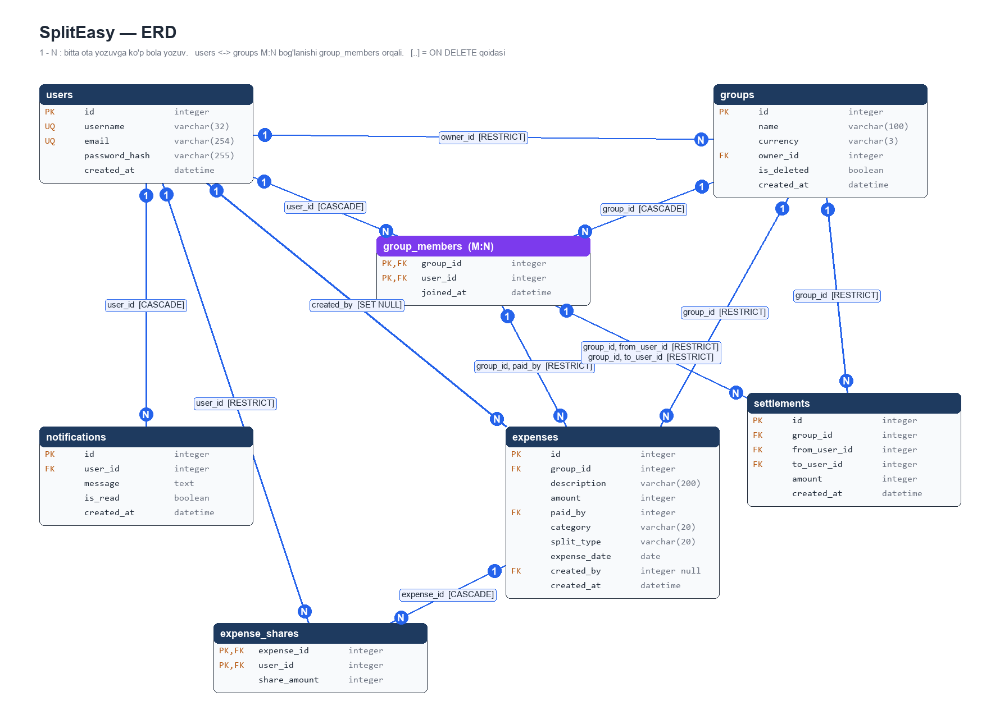

# SplitEasy — ma'lumotlar bazasi

Ushbu hujjat texnik topshiriqning 10-bo'limiga (10.7) muvofiq bazaning tuzilishi,
normalizatsiyasi, cheklovlari, indekslari va tranzaksiya qarorlarini tushuntiradi.

| Manba | Fayl |
|---|---|
| ERD | [`docs/erd.png`](erd.png) — `poetry run python scripts/draw_erd.py` bilan ORM'dan chiziladi |
| Qo'lda yozilgan sxema | [`docs/schema.sql`](schema.sql) |
| Migratsiyalar | [`migrations/versions/`](../migrations/versions) |
| ORM modellari | [`app/repositories/sqlalchemy/orm_models.py`](../app/repositories/sqlalchemy/orm_models.py) |

Uchala manba (Alembic, `schema.sql`, ORM) **bir xil sxema** beradi — buni
`tests/integration/test_schema.py` SQLite katalogi (`PRAGMA table_info`,
`foreign_key_list`, `index_list`) va `CHECK` ifodalari bo'yicha solishtiradi.

Bazani yaratish:

```bash
poetry run alembic upgrade head          # bo'sh bazadan to'liq sxema
poetry run alembic downgrade base        # hammasini qaytarish
```

---

## 1. ERD va jadvallar



| Jadval | Vazifasi | Bog'lanishlar |
|---|---|---|
| `users` | Ro'yxatdan o'tgan foydalanuvchilar | — |
| `groups` | Xarajat guruhlari | `users` 1:N `groups` (ega) |
| `group_members` | A'zolik | `users` **M:N** `groups` shu jadval orqali |
| `expenses` | Xarajatlar | `groups` 1:N, `group_members` 1:N (to'lovchi), `users` 1:N (muallif) |
| `expense_shares` | Har bir ishtirokchining ulushi | `expenses` 1:N, `users` 1:N |
| `settlements` | Qarzni yopish to'lovlari | `groups` 1:N, `group_members` 1:N (ikki marta: yuboruvchi, oluvchi) |
| `notifications` | Ilova ichidagi bildirishnomalar | `users` 1:N |

Texnik topshiriqdagi ro'yxatdan farqlar:

- `users.name` o'rniga **`username`** (DESIGN.md 5.1 bo'yicha, unikal, login uchun). ⚠️ TZ'da
  `name` — qaysi biri qolishi jamoa bilan kelishilishi kerak (PR #9 da ko'tarilgan).
- `expenses` va `settlements` to'lovchi/ishtirokchini to'g'ridan-to'g'ri `users` ga emas,
  `group_members (group_id, user_id)` ga **kompozit FK** bilan bog'laydi (3-bo'lim).

---

## 2. Normalizatsiya

Barcha jadvallar **3NF** da: har bir jadvalda kalit bo'lmagan ustunlar faqat butun kalitga
bog'liq (2NF) va bir-biriga tranzitiv bog'liq emas (3NF). Takrorlanuvchi guruhlar yo'q,
har bir katakda bitta qiymat (1NF): masalan, ishtirokchilar ro'yxati ustunda vergul bilan
emas, `expense_shares` da alohida qatorlarda.

| Jadval | Kalit | Funksional bog'liqliklar | Izoh |
|---|---|---|---|
| `users` | `id` (yana `username`, `email` — nomzod kalitlar) | `id → username, email, password_hash, created_at` | Nomzod kalitlar ham to'liq aniqlaydi — BCNF |
| `groups` | `id` | `id → name, currency, owner_id, is_deleted, created_at` | Ega nomi bu yerda **saqlanmaydi** (`owner_id → username` tranzitiv bo'lardi) |
| `group_members` | `(group_id, user_id)` | `(group_id, user_id) → joined_at` | `joined_at` butun kalitga bog'liq — 2NF |
| `expenses` | `id` | `id → group_id, description, amount, paid_by, category, split_type, expense_date, created_by, created_at` | Valyuta guruhdan olinadi, takrorlanmaydi |
| `expense_shares` | `(expense_id, user_id)` | `(expense_id, user_id) → share_amount` | Pastdagi denormalizatsiyaga qarang |
| `settlements` | `id` | `id → group_id, from_user_id, to_user_id, amount, created_at` | — |
| `notifications` | `id` | `id → user_id, message, is_read, created_at` | — |

### Ongli denormalizatsiya: `expense_shares.share_amount`

`share_amount` — **hosila ma'lumot**: uni `expenses.amount`, `split_type` va ishtirokchilar
qiymatlaridan strategiya yordamida qayta hisoblash mumkin. Shunga qaramay saqlanadi, chunki:

1. **Balans tez hisoblanadi** — bitta `SUM(share_amount) GROUP BY user_id`, har bir xarajat
   uchun strategiyani qayta ishga tushirish shart emas.
2. **Yaxlitlash natijasi o'zgarmaydi** — qoldiq tiyinlar kimga tushgani yozib qo'yiladi;
   kelajakda bo'lish algoritmi o'zgarsa ham eski xarajatlar o'zgarmaydi.
3. Foiz/ulush qiymatlarini (`value`) alohida saqlash kerak bo'lmaydi.

**Xavf:** ulushlar yig'indisi `amount` ga teng bo'lmay qolishi mumkin. SQLite qatorlararo
`CHECK` ni qo'llab-quvvatlamaydi, shuning uchun himoya uch qatlamda:

- domen: `Expense.__post_init__` yig'indi `amount` ga teng bo'lmasa xato beradi
  (`tests/unit/test_models.py`);
- tranzaksiya: xarajat va uning barcha ulushlari bitta tranzaksiyada yoziladi (7-bo'lim);
- baza: `share_amount >= 0`, `amount > 0` va `(expense_id, user_id)` PK.

### Soft delete: `groups.is_deleted`

- Guruh o'chirilganda qator qolaveradi — xarajat va to'lovlar tarixi saqlanadi
  (`expenses.group_id` va `settlements.group_id` `ON DELETE RESTRICT`).
- **So'rovlarga ta'siri:** har bir ro'yxat so'rovi `is_deleted = 0` filtrini qo'shishi shart
  (`SqlAlchemyGroupRepository.list_for_user`); servis o'chirilgan guruhga 404 qaytaradi.
- **UNIQUE ga ta'siri:** hozir guruh nomi unikal emas, shuning uchun muammo yo'q. Agar
  kelajakda "bir egada bir xil nomli guruh bo'lmasin" talabi qo'shilsa, oddiy
  `UNIQUE(owner_id, name)` o'chirilgan guruh nomini qayta ishlatishga to'sqinlik qiladi —
  buning o'rniga **qisman indeks** kerak bo'ladi:
  `CREATE UNIQUE INDEX ... ON groups (owner_id, name) WHERE is_deleted = 0`.

---

## 3. Cheklovlar (constraints)

Hamma qoidalar bazaning o'zida e'lon qilingan — faqat Python'dagi tekshiruvga tayanilmaydi.
Testlar: `tests/integration/test_constraints.py`, `test_group_repository.py`.

| Cheklov | Jadval | Nima | Nega |
|---|---|---|---|
| `pk_*` | hammasi | PRIMARY KEY | Har bir qator yagona aniqlanadi |
| `pk_group_members` | `group_members` | PK `(group_id, user_id)` | Bir kishi guruhga ikki marta qo'shilmaydi |
| `pk_expense_shares` | `expense_shares` | PK `(expense_id, user_id)` | Bir xarajatda bir kishining bitta ulushi |
| `uq_users_email`, `uq_users_username` | `users` | UNIQUE | Login yagona; servis 409 qaytaradi |
| NOT NULL | hammasi | `created_by` dan boshqa barcha ustunlar | Majburiy maydonlar bo'sh qolmaydi |
| `ck_groups_name_not_blank` | `groups` | `length(trim(name)) > 0` | Faqat bo'shliqdan iborat nom |
| `ck_groups_currency_code` | `groups` | `length(currency) = 3` | ISO kod (`UZS`, `USD`) |
| `ck_expenses_amount_positive` | `expenses` | `amount > 0` | Nol yoki manfiy xarajat yo'q |
| `ck_expenses_description_not_blank` | `expenses` | `length(trim(description)) > 0` | — |
| `ck_expenses_category_valid` | `expenses` | `category IN (...)` | Domen `Category` enum'i bilan bir xil |
| `ck_expenses_split_type_valid` | `expenses` | `split_type IN (...)` | Domen `SplitType` enum'i bilan bir xil |
| `ck_expense_shares_share_amount_non_negative` | `expense_shares` | `share_amount >= 0` | Ulush manfiy bo'lmaydi (nol mumkin: "aniq summa"da 0) |
| `ck_settlements_amount_positive` | `settlements` | `amount > 0` | — |
| `ck_settlements_different_users` | `settlements` | `from_user_id <> to_user_id` | O'ziga o'zi to'lamaydi |
| `ck_notifications_message_not_blank` | `notifications` | `length(trim(message)) > 0` | — |
| `fk_expenses_group_id_paid_by_group_members` | `expenses` | kompozit FK → `group_members` | **To'lovchi shu guruh a'zosi bo'lishi shart** |
| `fk_settlements_group_id_{from,to}_user_id_group_members` | `settlements` | kompozit FK → `group_members` | Ikkala tomon ham guruh a'zosi |

Cheklov nomlari `NAMING_CONVENTION` (`app/infrastructure/database.py`) bo'yicha
deterministik — Alembic, `schema.sql` va ORM bir xil nom beradi.

**SQLite eslatmasi:** foreign key'lar faqat `PRAGMA foreign_keys = ON` bo'lsa ishlaydi va bu
**har bir ulanishda** qayta yoqilishi kerak. `make_engine()` buni `connect` hodisasida
bajaradi (ilova, testlar va Alembic uchun bir xil).

### `ON DELETE` qoidalari

| FK | Qoida | Nega |
|---|---|---|
| `groups.owner_id → users` | RESTRICT | Egasi bor guruhni yetim qoldirmaslik |
| `group_members.group_id → groups` | CASCADE | A'zolik guruhsiz ma'nosiz (guruhlar odatda soft delete qilinadi) |
| `group_members.user_id → users` | CASCADE | Foydalanuvchi o'chsa a'zoligi ham ketadi — lekin moliyaviy tarixi bo'lsa pastdagi RESTRICT to'xtatadi |
| `expenses.group_id → groups` | RESTRICT | Moliyaviy tarix o'chmasligi kerak — guruh soft delete qilinadi |
| `expenses.(group_id, paid_by) → group_members` | RESTRICT | Xarajat to'lagan a'zoni guruhdan chiqarib bo'lmaydi (servis 409 qaytaradi) |
| `expenses.created_by → users` | **SET NULL** | Muallif — faqat ma'lumot uchun; u o'chsa xarajat qoladi |
| `expense_shares.expense_id → expenses` | CASCADE | Ulush xarajatning bir qismi; tahrirlashda eski ulushlar o'chiriladi |
| `expense_shares.user_id → users` | RESTRICT | Kimdir qarzdor bo'lgan ulushni yo'qotmaslik |
| `settlements.group_id → groups` | RESTRICT | Moliyaviy tarix |
| `settlements.(group_id, from/to) → group_members` | RESTRICT | To'lovda qatnashgan a'zoni chiqarib bo'lmaydi |
| `notifications.user_id → users` | CASCADE | Bildirishnoma faqat egasi uchun kerak |

**Ma'lum cheklov:** `expense_shares` da `group_id` yo'q, shuning uchun "ulush egasi guruh
a'zosi" qoidasini kompozit FK bilan ta'minlab bo'lmaydi (buning uchun `group_id` ni
takrorlash — 3NF'ni buzish kerak bo'lardi). Bu qoidani xarajat servisi tekshiradi;
faqat ulushda qatnashgan a'zoni chiqarishni taqiqlash ham servisda (`GroupService` dagi TODO).

---

## 4. Xom SQL hisobot so'rovlari

Hisobotlar ORM orqali emas, xom SQLda yozilgan:
[`report_queries.py`](../app/repositories/sqlalchemy/report_queries.py). Ular
`ReportRepository` interfeysi (`app/repositories/interfaces/report_repository.py`) ortida;
`ReportService` faqat interfeysni biladi (ISP, DIP). Har bir so'rov ustida izoh bor: nimani
qaytaradi va qaysi jadvallarni bog'laydi. Barcha qiymatlar parametr (`:group_id`) — satr
qo'shib so'rov yasalmaydi (SQL injection testi: `test_parameters_are_bound_not_concatenated`).

| # | Hisobot | SQL vositasi | API | TZ |
|---|---|---|---|---|
| 1 | A'zolarning sof balansi | `JOIN`, `SUM`, `GROUP BY`, `COALESCE`, `LEFT JOIN` subquery'lar | `GET /api/groups/{id}/reports/balances` | FR-16 |
| 2 | Kategoriya bo'yicha jami | `GROUP BY`, `ORDER BY` | `.../reports/categories` | FR-26 |
| 3 | Oylik dinamika | `strftime('%Y-%m', ...)`, `GROUP BY` | `.../reports/monthly` | FR-26 |
| 4 | Eng ko'p to'lagan 3 a'zo | `JOIN`, `ORDER BY`, `LIMIT` | `.../reports/top-payers?limit=3` | — |
| 5 | Hali qatnashmagan a'zolar | `NOT EXISTS` (ikki marta) | `.../reports/inactive-members` | — |
| 6 | O'rtachadan katta xarajatlar | skalyar subquery `(SELECT AVG(...))` | `.../reports/above-average` | — |
| 7 | O'sib boruvchi yig'indi | window: `SUM() OVER (ORDER BY expense_date, id)` | `.../reports/running-total` | — |
| 8 | Foydalanuvchining barcha guruhlar bo'yicha holati | `WITH` (CTE), `UNION ALL` | `GET /api/reports/overview` | FR-19 |

**Kesishgan tekshiruv:** 1-so'rov natijasi Python'dagi `calculate_balances` (domen) bilan
aynan bir xil — `tests/integration/test_reports.py::test_1_sql_balances_equal_domain_calculation`.
8-so'rov ham har bir guruhda 1-so'rov bilan bir xil balans berishi tekshiriladi.
Guruh hisobotlarini faqat a'zolar ko'radi (a'zo emas → 403, guruh yo'q → 404).

8-so'rovdagi "jami sizdan qarz / jami sizga qarz" **valyuta bo'yicha alohida** hisoblanadi:
UZS va USD guruhlaridagi summalarni qo'shib bo'lmaydi.

---

## 5. Indekslar

PRIMARY KEY va UNIQUE o'z indeksini o'zi yaratadi (`sqlite_autoindex_*`), ular takrorlanmaydi
(masalan, `users.email` — login so'rovi uchun alohida indeks kerak emas).
Qo'shimcha indekslar alohida migratsiyalarda (`0004`, `0005`) — benchmark ularni
`alembic downgrade 0003` / `upgrade head` bilan o'chirib-yoqadi.

| Indeks | So'rov | Ustunlar tartibi nega shunday |
|---|---|---|
| `ix_group_members_user_id` | "Mening guruhlarim" (`WHERE user_id = ?`) | PK `(group_id, user_id)` faqat `group_id` bo'yicha qidirishga yaraydi |
| `ix_expenses_group_id_expense_date_id` (**composite**) | Guruh xarajatlari, sana bo'yicha, sahifalab (FR-13); kategoriya filtri (FR-14) | `group_id` — tenglik filtri birinchi; keyin `expense_date, id` — tartiblash indeksdan olinadi (`USE TEMP B-TREE` yo'q), `id` bir xil sanalarni ajratadi |
| `ix_expenses_group_id_paid_by_amount` (**composite, covering**) | 1-, 4-, 8-so'rovlar: guruhda kim qancha to'lagan; a'zoni o'chirishdagi kompozit FK tekshiruvi | `group_id, paid_by` — filtr va `GROUP BY`; `amount` jadvalga murojaat qilmaslik uchun (`0005`, pastga qarang) |
| `ix_expense_shares_user_id` | Foydalanuvchining ulushlari (8-so'rov, FR-19) | PK `(expense_id, user_id)` `user_id` bo'yicha yordam bermaydi |
| `ix_settlements_group_id_created_at` | 1-so'rov, guruh to'lovlari tarixi | Filtr, keyin tartib |
| `ix_notifications_user_id_created_at` | "Mening bildirishnomalarim", yangilari birinchi | Filtr, keyin tartib |

### O'lchov natijalari

`scripts/seed.py` (1 000 foydalanuvchi, 200 guruh, 100 000 xarajat, 300 221 ulush, 10 000
to'lov, 50 000 bildirishnoma; `random.seed(42)`) va `scripts/benchmark.py` (1 ta qizdirish +
7 ta o'lchov, o'rtacha). To'liq natija va har bir so'rovning `EXPLAIN QUERY PLAN` i:
[`docs/benchmark.md`](benchmark.md).

| So'rov | Indekssiz (ms) | Indeks bilan (ms) | Reja (oldin → keyin) |
|---|---:|---:|---|
| Guruh xarajatlari, 1-sahifa (FR-13) | 15.6 | 0.11 | `SCAN` → `SEARCH ... ix_expenses_group_id_expense_date_id` |
| Kategoriya bo'yicha filtr (FR-14) | 21.8 | 0.15 | `SCAN` → `SEARCH ... ix_expenses_group_id_expense_date_id` |
| A'zolar balansi (1-so'rov) | 39.9 | 9.3 | `SCAN` → `SEARCH ... COVERING INDEX ix_expenses_group_id_paid_by_amount` |
| Foydalanuvchi umumiy holati (8-so'rov) | 64.2 | 14.4 | `SCAN` → `SEARCH ... COVERING INDEX` |
| O'qilmagan bildirishnomalar | 7.3 | 0.10 | `SCAN` → `SEARCH ... ix_notifications_user_id_created_at` |
| Eng ko'p to'laganlar (4-so'rov) | 25.1 | 0.70 | `SCAN` → `SEARCH ... COVERING INDEX` |

Hammasi NFR-5 talabidan (100 000 xarajatda asosiy ro'yxatlar < 100 ms) ancha past.
Raqamlar mashinaga bog'liq va har yurgizishda biroz farq qiladi; reja (`SCAN` → `SEARCH`)
o'zgarmaydi.

### O'lchov asosida qabul qilingan va rad etilgan qarorlar

| Variant | Natija (ms) | Qaror |
|---|---|---|
| `expenses(group_id, paid_by)` ga `amount` qo'shish (covering) | 4-so'rov 3.9 → 0.5, 1-so'rov ~1 ms tezroq | ✅ **Qabul** (`0005`): eski indeks almashtiriladi, yangi indeks qo'shilmaydi |
| `expense_shares(expense_id, user_id, share_amount)` (covering) | 1-so'rov ~2 ms tezroq | ❌ 300 000 qatorli jadvalning nusxasi, har bir yozuvni sekinlashtiradi — foyda kichik |
| `expense_shares(user_id, expense_id, share_amount)` | 8-so'rov 13 → 9.5 | ❌ xuddi shu sabab; 8-so'rov allaqachon 15 ms atrofida |
| `expenses(group_id, category)` (TZ namunasi) | — | ❌ kategoriya filtri busiz ham **0.15 ms**: guruhda ~500 xarajat, sana indeksi bo'yicha yurib birinchi 20 ta mosini tez topadi |
| `notifications(user_id, is_read)` (TZ namunasi) | — | ❌ mavjud `(user_id, created_at)` bilan **0.10 ms**; `is_read` ikki qiymatli |

**Indekslanmagan ustunlar:**

- `groups.is_deleted` — faqat ikki qiymat, deyarli hammasi `0`; indeks selektiv emas, yozishni
  sekinlashtiradi xolos.
- `groups.owner_id` — foydalanuvchi o'chirish ilovada yo'q, "egasi bo'yicha guruhlar" so'rovi
  ham yo'q; FK tekshiruvi kamdan-kam ishlaydi.

### Bonus: OFFSET va keyset pagination

Butun `expenses` jadvalidagi 90 000-qatordan keyingi sahifa:

| Usul | ms | Reja |
|---|---:|---|
| `ORDER BY id DESC LIMIT 20 OFFSET 90000` | ~10.4 | `SCAN expenses` — 90 000 qatorni o'qib tashlab yuboradi |
| `WHERE id < :after_id ORDER BY id DESC LIMIT 20` (keyset) | ~0.07 | `SEARCH ... INTEGER PRIMARY KEY` — darhol kerakli joyga |

OFFSET narxi sahifa raqami bilan chiziqli o'sadi, keyset esa o'zgarmaydi (~150× farq). Shuning
uchun `ix_expenses_group_id_expense_date_id` oxirida `id` bor: guruh xarajatlari ro'yxatini
`(expense_date, id) < (:last_date, :last_id)` sharti bilan keyset usulida sahifalash mumkin.

---

## 6. N+1 muammosi

> ⏳ Keyingi bosqich: xarajatlar ro'yxati (TZ 10.6). Hozircha guruh a'zolarining
> ismlari bitta `IN (...)` so'rovi bilan olinadi (`UserRepository.get_many`) — a'zolar
> soniga qarab so'rovlar ko'paymaydi.

---

## 7. Tranzaksiyalar va ACID

**Hozirgi holat:** har bir HTTP so'rov bitta sessiya va bitta tranzaksiyada ishlaydi
(`get_session`): muvaffaqiyatda `commit`, xatoda `rollback`. Masalan, guruh yaratish
(`groups` qatori + egasining `group_members` qatori) bitta tranzaksiya — yarim yaratilgan
guruh qolmaydi. Kutilgan xatolar (takroriy a'zo, tarixi bor a'zoni chiqarish) **savepoint**
(`begin_nested`) ichida ushlanadi: faqat o'sha qadam bekor qilinadi, tranzaksiya davom etadi.

> ⏳ TZ 10.4 tranzaksiya chegarasini **servis qatlamida** belgilashni talab qiladi.
> Xarajat servisi bilan birga Unit of Work qo'shiladi: servis `with uow:` ichida
> xarajat va barcha ulushlarni yozadi.

| ACID | Loyihada qayerda |
|---|---|
| **A**tomicity | Xarajat va uning ulushlari, guruh va egasining a'zoligi — yo hammasi, yo hech biri yoziladi |
| **C**onsistency | `CHECK`, `FOREIGN KEY`, `UNIQUE` har bir tranzaksiya oxirida bazani to'g'ri holatda saqlaydi; buzilsa `IntegrityError` va `rollback` |
| **I**solation | SQLite yozishda butun bazani bloklaydi — bir vaqtda ikki yozuvchi bir-birining yarim natijasini ko'rmaydi |
| **D**urability | `commit` dan keyin ma'lumot faylda (SQLite jurnali), server qayta ishga tushsa ham qoladi |

---

## Migratsiyalar

| Revizion | Mazmuni |
|---|---|
| `0001` | `users` |
| `0002` | `groups`, `group_members` |
| `0003` | `expenses`, `expense_shares`, `settlements`, `notifications` |
| `0004` | so'rov indekslari |
| `0005` | `(group_id, paid_by)` indeksini `amount` bilan covering qilish (o'lchov asosida) |

Har birida `upgrade` va `downgrade` bor. `alembic check` ORM bilan farq yo'qligini
ko'rsatadi; `test_schema.py` esa `upgrade head`, `downgrade base` va indeks
migratsiyasini qaytarishni tekshiradi.
